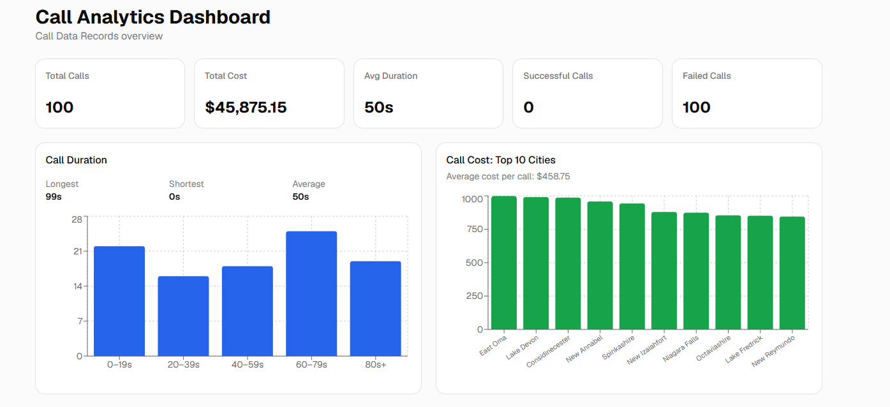
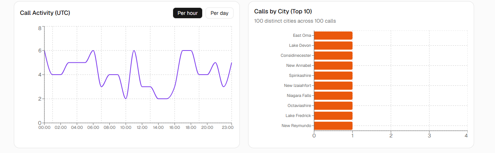
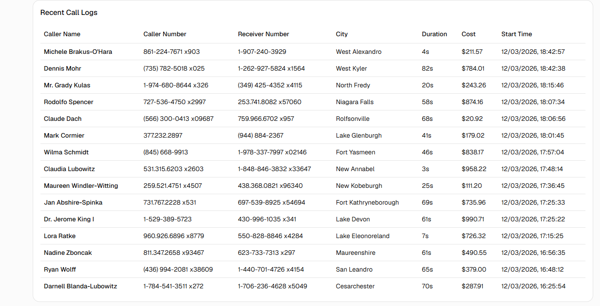

# Call Analytics Dashboard

A SaaS-style analytics dashboard for **Call Data Records (CDR)**. It fetches call records from a REST API, turns the raw data into metrics, and visualises call activity, duration, cost and location in a responsive interface.

Built for the *Software Development Internship, Week 2, Assignment 2* (London Success Academy).

**Live demo:** https://call-analytics-dashboard-ruby.vercel.app/
**Repository:** https://github.com/Mahanaliyari/call-analytics-dashboard

## Screenshots







## Features

- **KPI summary cards**: total calls, total cost, average duration, successful calls and failed calls.
- **Call duration analytics**: longest, shortest and average call, plus a bar chart of calls grouped by duration range.
- **Call cost analytics**: average cost per call and a bar chart of total cost for the top 10 cities.
- **Call activity timeline**: a line chart of calls per hour or per day, switchable with a toggle (times in UTC).
- **Calls by city**: a bar chart of the top 10 cities by number of calls.
- **Recent call logs**: a table of the 15 most recent calls (caller name, caller number, receiver number, city, duration, cost, start time).
- **Loading and error states** for the API request.
- **Responsive layout**: cards and charts reflow on smaller screens and the table scrolls horizontally.

## Tech Stack

| Purpose | Technology |
|---|---|
| UI library | [React 19](https://react.dev/) |
| Language | [TypeScript](https://www.typescriptlang.org/) |
| Build tool / dev server | [Vite](https://vite.dev/) |
| Styling | [Tailwind CSS v4](https://tailwindcss.com/) |
| UI components | [shadcn/ui](https://ui.shadcn.com/) (Card, Table) |
| Charts | [Recharts](https://recharts.org/) |
| Linting | ESLint with typescript-eslint |
| Hosting | [Vercel](https://vercel.com/) |

## Data Source

Data is fetched from a mock REST API:

```
https://69b30b45e224ec066bdb55a0.mockapi.io/api/v1/cdr
```

Each record contains `callerName`, `callerNumber`, `receiverNumber`, `city`, `callDirection`, `callStatus`, `callDuration` (seconds), `callCost`, `callStartTime`, `callEndTime` and `id`.

## Data Notes

The dataset returned by the API (100 records) has some characteristics worth knowing when reading the dashboard:

- **Every record has `callStatus: false`**, so the dashboard shows 0 successful calls and 100 failed calls. This reflects the data, not a calculation error.
- **Every record has `callDirection: false`** (outbound), so there is no inbound/outbound split to visualise.
- **`callEndTime` is unreliable.** In many records the end time is earlier than the start time, and the gap between the two does not match `callDuration`. All duration metrics therefore use the `callDuration` field and ignore end time.
- **Every city appears exactly once** (100 distinct cities across 100 calls), so the "Calls by City" chart is flat by design and the cost chart effectively shows the 10 most expensive individual calls.
- **All calls fall on 11-12 March 2026**, so the per-day view has only two points. The per-hour view is the more informative one.
- `callCost` is returned as a string and is converted to a number before any calculation.

## Project Structure

```
src/
  components/
    ui/                  shadcn/ui components (Card, Table)
    KpiCards.tsx         summary cards
    DurationAnalytics.tsx
    CostAnalytics.tsx
    CallTimeline.tsx
    CallsByCity.tsx
    CallTable.tsx
  hooks/
    useCalls.ts          fetches the API and tracks loading/error state
  lib/
    analytics.ts         pure functions that turn raw records into metrics
    utils.ts
  types.ts               CallRecord type
  App.tsx                dashboard layout
  main.tsx               app entry point
```

Data flows in one direction: `useCalls()` fetches the records, `App` passes them to each component as props, and each component calls the functions in `analytics.ts` to compute what it displays.

## Running Locally

Requires a current LTS version of [Node.js](https://nodejs.org/).

```bash
git clone https://github.com/Mahanaliyari/call-analytics-dashboard.git
cd call-analytics-dashboard
npm install
npm run dev
```

Then open the local URL printed in the terminal (usually http://localhost:5173).

### Other scripts

| Command | Description |
|---|---|
| `npm run build` | Type-check and create a production build in `dist/` |
| `npm run preview` | Preview the production build locally |
| `npm run lint` | Run ESLint |

## Deployment

The app is deployed on Vercel. Pushing to the `main` branch triggers an automatic redeploy.

- Framework preset: Vite
- Build command: `npm run build`
- Output directory: `dist`

## Author

Mahan, [@Mahanaliyari](https://github.com/Mahanaliyari)
